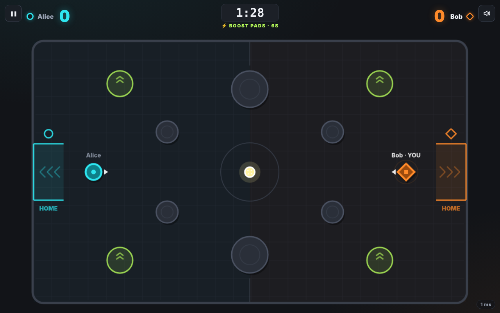
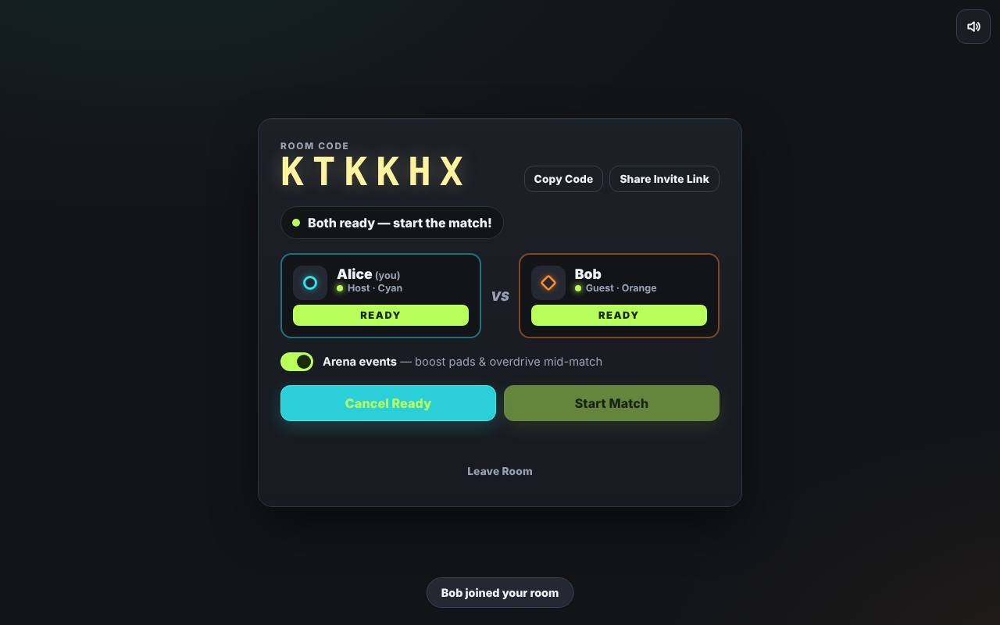
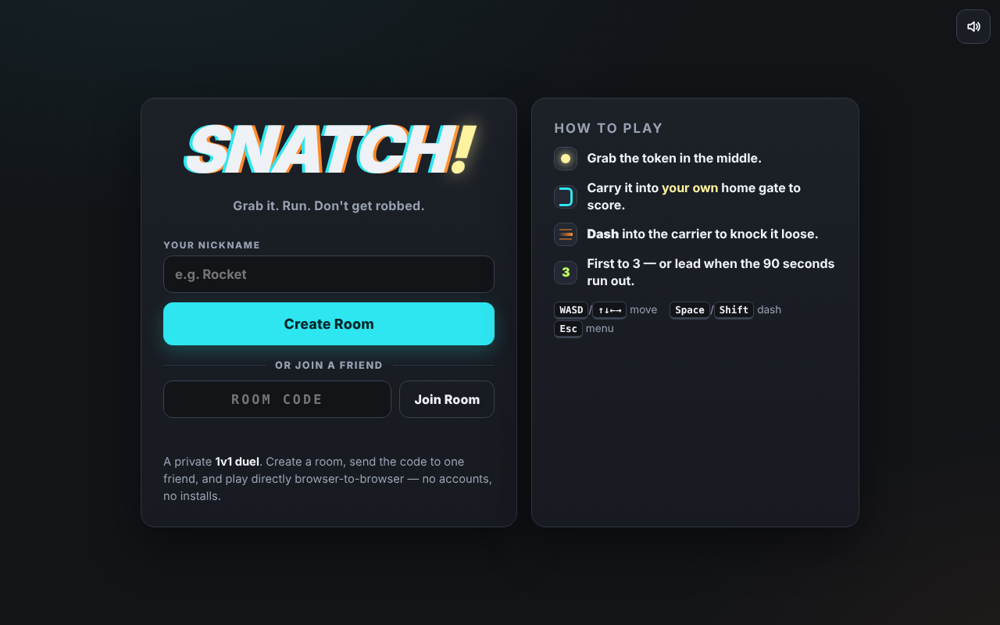
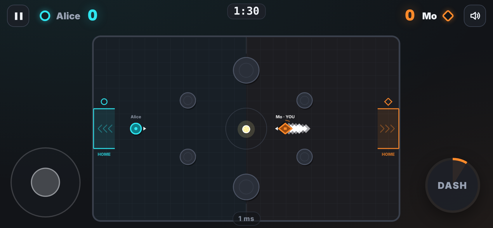

# SNATCH!

**Grab it. Run. Don't get robbed.**

A real-time 1v1 browser arcade duel. Two friends share a six-character room code, connect browser-to-browser over WebRTC, and fight over a single token: grab it, carry it into **your own** home gate, and dash into the carrier to knock it loose. First to three goals — or whoever leads when 90 seconds run out (tied → sudden death).

- **No accounts, no backend you deploy, no database.** The site is a static bundle on GitHub Pages.
- **Host-authoritative peer-to-peer.** The room creator's browser runs the official simulation; the guest sends only inputs.
- **Desktop + mobile.** Keyboard on desktop; virtual joystick and dash button on touch devices.
- **Open lobbies on the home page.** Public rooms are listed live for every visitor; one click to join. Private rooms (code/link only) are still available.
- **Peer-to-peer voice chat.** Talk while you play; audio goes directly between the two browsers on the same connection as the game.
- **Stack:** TypeScript · Vite · Phaser 3 · Trystero (WebRTC data channels) · plain HTML/CSS · GitHub Actions.

| Arena (guest view, boost-pad event) | Lobby |
|---|---|
|  |  |
| **Menu** | **Phone, landscape** |
|  |  |

---

## Contents

1. [Quick start](#1-quick-start)
2. [Publish on GitHub Pages](#2-publish-on-github-pages)
3. [How to play](#3-how-to-play)
4. [Rooms and invite links](#4-rooms-and-invite-links)
5. [Architecture](#5-architecture)
6. [Networking design](#6-networking-design)
7. [Project layout](#7-project-layout)
8. [Tuning](#8-tuning)
9. [Testing](#9-testing)
10. [Limitations (read this)](#10-limitations-read-this)
11. [Troubleshooting](#11-troubleshooting)
12. [Verification status](#12-verification-status)

---

## 1. Quick start

Requires **Node.js 20.19+ or 22.12+** (Vite 8 requirement) and npm.

```bash
npm install          # install dependencies
npm run dev          # local dev server (http://localhost:5173, also on your LAN)
npm test             # unit tests (Vitest)
npm run build        # type-check + production build into dist/
npm run preview      # serve dist/ locally to sanity-check the production build
```

To try a match locally, open the dev URL in **two different browser profiles** (or one normal + one private window), create a room in one and join in the other. Two tabs of the same profile usually work too.

`npm run dev` listens on your LAN (`server.host: true`), so a phone on the same Wi-Fi can open `http://<your-computer-ip>:5173`. Note: some mobile browsers restrict WebRTC/clipboard on plain-HTTP non-localhost origins; the deployed HTTPS site is the reliable way to test on phones.

---

## 2. Publish on GitHub Pages

The repository includes `.github/workflows/deploy.yml`, which builds and deploys on every push to `main`.

**One-time setup:**

1. Create a GitHub repository (e.g. `snatch`) and push this project to its `main` branch:
   ```bash
   git init
   git add .
   git commit -m "SNATCH! v1"
   git branch -M main
   git remote add origin https://github.com/<you>/snatch.git
   git push -u origin main
   ```
2. On GitHub, open **Settings → Pages**.
3. Under **Build and deployment → Source**, choose **GitHub Actions** (not "Deploy from a branch").
4. Open the **Actions** tab. The *Deploy SNATCH! to GitHub Pages* run starts on the push (if it ran before step 3 and failed, click **Re-run all jobs**, or trigger it manually with **Run workflow**).
5. When it finishes, the site is live at `https://<you>.github.io/snatch/` (the URL also appears on the workflow run and in Settings → Pages).

**Nothing else is needed:** no secrets, no environment variables, no server.

**Why it works under a sub-path:** `vite.config.ts` uses a *relative* base (`base: './'`), and the game has no client-side routes. The same build works at `https://<you>.github.io/<any-repo-name>/`, at a custom domain root, or in a sub-folder. Invite links are built from the page's actual `location.pathname`, so they always point at the deployed copy. If you ever need an absolute base, build with `BASE_PATH=/snatch/ npm run build`.

**Workflow permissions** (already set in the file): `contents: read`, `pages: write`, `id-token: write`. If your organisation restricts Actions, make sure **Settings → Actions → General → Workflow permissions** allows these, and that the `github-pages` environment isn't blocked by a protection rule for `main`.

---

## 3. How to play

| | Desktop | Touch |
|---|---|---|
| Move | `W A S D` or arrow keys | Virtual joystick (lower-left) |
| Dash | `Space` or `Shift` | **DASH** button (lower-right; ring shows cooldown) |
| Menu | `Esc` | ❚❚ button (top-left) |

**Rules**

- The token spawns in the centre. Touch it to pick it up.
- Carry it into **your own home gate** (cyan ⭘ = left, orange ◇ = right). Entering the opponent's gate does nothing.
- Carrying slows you by ~15%.
- **Dash into the carrier** to knock the token loose (knockback, brief stun, screen shake). The token drops near the collision and can't be picked up for 0.35 s.
- A player who was just hit is briefly immune (no stun-locking). Each dash can land only one hit. Walking into the carrier never steals.
- After a goal both players reset to their home positions and the token returns to the centre.
- First to **3** wins immediately. At **90 s** the leader wins; a tie goes to **sudden death** (next goal wins).
- Optional **arena events** (host toggles them in the lobby): *Boost pads* appear in the corners for a few seconds; *Overdrive* slashes the dash cooldown.

Players are distinguished by **colour and shape** (cyan circle vs. orange diamond) everywhere — arena, HUD, lobby, gates — so the game stays readable with colour-vision deficiencies.

Sound is synthesised in the browser (no audio files). Use the speaker button to mute. If the browser blocks audio, the game simply stays silent. The game honours the OS **reduce motion** setting (no screen shake, fewer particles, no idle bobbing) and offers its own toggle in the in-match menu.

---

## 4. Rooms and invite links

- **Create Room** generates a six-character code from an alphabet with no look-alike characters (no `O/0`, `I/1/L`), using `crypto.getRandomValues` with rejection sampling.
- **Copy Code** copies the code. **Share Invite Link** opens the native share sheet on phones or copies a link like `https://<you>.github.io/snatch/?room=ABC234`. Opening it pre-fills the code.
- The **host** is whoever created the room (cyan, player 1). The **guest** is whoever joined (orange, player 2).
- Both players press **Ready**; then the host presses **Start Match**. Everyone sees the same 3-2-1-GO countdown.
- After a match, both press **Play Again** to rematch over the same connection (no re-pairing). **Lobby** returns both players to the lobby. **Main Menu** leaves the room.

A code is just a rendezvous name: if you type a code nobody is hosting, you sit in an empty room until the **25-second timeout** tells you no host was found. A third person who opens a full room is refused with *"Room is full"*.

### Public rooms and the "Open lobbies" list

- Under **Create Room** there's a **List my room publicly** switch (on by default, remembered per browser). The host can also flip **Public room** in the lobby at any time.
- While a public room is **waiting for an opponent**, it appears in **Open lobbies** on everyone's home page with the host's nickname, room code, how long it's been waiting and whether arena events are on. Visitors click **Join** — that's the same join flow as typing the code.
- As soon as someone joins, the room disappears from everyone's list. If they leave, it's listed again. Switching to private, leaving, or starting a match also removes it.
- **Private rooms are never announced** — only people with the code or invite link can find them.

**How it works without a server.** There's still no database or backend. A host announces its open room as a tiny, short-lived ("ephemeral") Nostr event on six of the same public relays Trystero already uses to pair browsers — every 12 s, and immediately when a new visitor arrives and asks *"who's open?"*. Relays forward these to whoever is listening but don't store them. Each visitor builds the list in their own browser; a listing expires 45 s after its host goes silent (e.g. closed tab), and an explicit *closed* message removes it instantly in the normal case. Relay sockets for the list are only open while you're on the home page or hosting a public room.

**Safety rules built in:** every message is validated and nicknames are sanitised; only the browser that first announced a code can update or close that listing; incompatible game versions are hidden; the list is capped at 40 rooms; hosts answer queries at most once every 3 s.

**What this means in practice:**
- **Public means public.** Anyone who opens the site can see your nickname and join. There's no moderation or blocking — use a private room for friends.
- The list is **best-effort**. If the relays are slow or blocked on your network, the status dot turns red (*Directory unreachable*) and the list may be empty even when rooms exist; joining by code still works.
- A listing can be up to ~45 s stale if a host's tab crashed. Joining it ends in *No host found*, and it's removed from your list.
- Keep a public room's tab **in the foreground**: background tabs get throttled and the listing may flicker out.
- Anyone can technically publish a fake listing to those relays. Joining one just times out; it can't affect a real game.

Local-only extras: your nickname, mute/reduce-motion preferences, and a small *"This device: N played · W–L"* record are kept in `localStorage`. They never leave your browser and are **not** a leaderboard.

---

## 4b. Voice chat

Once an opponent is connected, two buttons appear at the top-right (next to the sound button):

| Button | What it does |
|---|---|
| 🎙 **Your mic** | First tap asks for microphone permission and starts sending your voice. After that it toggles **mute/unmute** instantly. Keyboard: **V**. Green = live, red = muted. A ring pulses with your voice level. |
| 🎧 **Opponent** | Shows the opponent's mic state (off / live / muted) with a speaking ring. Tap to **silence them on your side only**. If your browser blocked audio autoplay it pulses yellow — tap once to hear them. |

How it works and what to expect:

- **P2P only.** Your microphone track is added to the *same* WebRTC peer connection the game already uses; Trystero renegotiates it over the existing data channel. No media server, no new service, nothing to deploy. If the game connected, voice will too.
- **Opt-in, per player.** Nobody's mic opens automatically. Each player decides independently; you can listen without talking.
- **Lives with the pairing, not the match.** Voice keeps working through lobby → match → results → rematch. When the opponent leaves or you leave the room, your microphone is released (the browser's mic indicator turns off).
- Browser processing is on: echo cancellation, noise suppression, auto gain. **Headphones still give the best result** — game sounds + speakers + mic can echo.
- **Requires HTTPS** (browsers only expose the microphone on secure origins). On `http://` the mic button explains this instead of failing silently.
- Bandwidth: Opus voice is roughly 30–50 kbit/s each way — negligible next to video, fine on mobile data.

## 5. Architecture

```
            ┌────────────── public Nostr relays (Trystero default) ──────────────┐
            │  only used to exchange WebRTC offers/answers (signalling)          │
            └──────────────▲───────────────────────────────▲─────────────────────┘
                           │ discovery                      │ discovery
┌──────────────────────────┴──────────┐     WebRTC      ┌──┴─────────────────────────────────┐
│ HOST browser (room creator, cyan)   │◀═══════════════▶│ GUEST browser (joiner, orange)      │
│                                      │  data channels  │                                     │
│  LocalInput ──▶ HostMatch            │                 │  LocalInput ──▶ GuestMatch          │
│                 • fixed 60 Hz sim    │◀── input 30 Hz ─│                 • sends input 30 Hz │
│                 • validates guest    │── snapshot 20 Hz▶│                 • interpolates snaps│
│                   input              │── control ─────▶│                 • predicts own body │
│                 • owns score/timer   │◀─ control ──────│                                     │
│  ArenaScene (Phaser) renders view    │                 │  ArenaScene (Phaser) renders view   │
└──────────────────────────────────────┘                 └─────────────────────────────────────┘
```

Separation of concerns:

| Layer | Files | Knows about |
|---|---|---|
| Rules | `src/game/simulation.ts`, `src/game/arena.ts` | Pure functions over plain objects. No DOM/Phaser/network. Unit-tested. |
| Runtime drivers | `src/game/match.ts`, `src/game/view.ts` | Fixed-step host loop, snapshot encode/decode, interpolation, prediction. |
| Network | `src/network/peerRoom.ts`, `src/network/messages.ts` | Trystero room, handshake, validators. Gameplay never imports Trystero. |
| Session | `src/lobby/lobbyManager.ts`, `src/lobby/roomCode.ts` | The multiplayer state machine (menu → lobby → match → results → rematch). |
| Rendering | `src/game/ArenaScene.ts` | Draws whatever `ViewState` it's given; effects driven by sim events. |
| UI | `src/ui/*`, `index.html`, `src/styles/main.css` | Plain DOM: menu, lobby, HUD, overlays, toast, audio, prefs. |

The Phaser render loop **sleeps** whenever you're not in a match, so menus and lobbies cost almost no CPU/battery.

---

## 6. Networking design

**Authority.** The host's simulation decides positions, velocities, collisions, dash cooldowns, knockback/stun, token carrier, scoring, the match clock, arena events, and the winner. The guest can only send `{direction x, direction y, dash counter}` — it has no message that carries a position or a score. Input is clamped on receipt and again inside the simulation.

**Rates.**

| Stream | Rate | Notes |
|---|---|---|
| Host simulation | 60 Hz fixed step | Own `setInterval` loop, independent of Phaser rendering; catches up through render hitches (up to 1 s). |
| Guest → host input | 30 Hz | Dash is a *monotonic counter*, so a quick tap between two sends is never lost. |
| Host → guest snapshot | 20 Hz | Compact arrays; ~300–400 bytes of JSON each (≈7 KB/s). Carries all effect events since the previous snapshot. |
| Rendering | display refresh | Host blends the last two sim steps; guest renders remote entities **100 ms in the past** (interpolation) and its own body via prediction. |

**Guest prediction.** The guest runs the same movement code for its own player, replays inputs the host hasn't acknowledged yet (each snapshot carries the last input sequence the host applied), and smooths any correction. Pickups, tackles and goals are never predicted — they always come from the host.

**Ordering and staleness.** Snapshots carry a match id and sequence number; anything older, duplicated, or from a previous match is dropped. Effect events carry ids and are de-duplicated. Inputs carry match id + sequence; stale ones are ignored. Each match (including rematches) gets a fresh id, so a late packet from match N can't affect match N+1.

**Message types** (`src/network/messages.ts`):

| Channel | Messages |
|---|---|
| Handshake (before a peer is admitted) | `hello` (app, protocol version, role, nickname, room) · `verdict` (accepted / `full` / `version` / `role` / `room`) |
| Directory (Nostr ephemeral events, not WebRTC) | `q` (who's open?) · `a` (announce: code, nickname, events, protocol, seconds open) · `x` (closed) |
| `ctl` (reliable control) | `lobby` (name, ready, arena-events setting) · `start` (match id) · `abort` · `end` (winner, scores, duration, reason) · `rematch` · `toLobby` · `leave` · `focus` (tab hidden/visible) · `voice` (mic on / muted) |
| Media (WebRTC audio track) | Opponent's microphone, Opus codec, same peer connection (protocol v2) |
| `inp` (guest → host) | `{m: matchId, s: seq, x, y, d: dashCount}` |
| `snap` (host → guest) | phase, timers, scores, both players, token, arena event, effect events, input ack, pause state |

**Admission (two-player cap).** Trystero's `onPeerHandshake` runs before a peer becomes active. Both sides exchange `hello`; the host accepts exactly one guest whose protocol version matches, and answers everyone else with `verdict: full`. Two guests (or two hosts) never pair. Messages from any peer other than the accepted opponent are ignored.

**Pauses and disconnects.**

- If the guest's input stream stops for 1.5 s, the host **pauses** the match (clock included) and both screens show *"Connection hiccup — waiting for opponent…"*. It resumes automatically.
- If either player switches tabs, the match pauses (browsers throttle background tabs, which would otherwise make the game unfair).
- If the peer actually leaves, the match is **stopped**, no result is recorded, and the remaining player gets a clear choice (host: back to the open lobby / main menu; guest: rejoin / main menu). No victory is awarded for a disconnect. **There is no host migration** — if the host leaves, the match is over.

**Fairness note.** Because the host *is* the server, the host has zero input latency and the guest has roughly half a round-trip. On normal connections (20–80 ms RTT) it's barely noticeable; on poor links the guest will feel it. That is the inherent trade-off of a backend-free, host-authoritative design.

**Signalling.** SNATCH! uses Trystero's **default strategy (Nostr)**: browsers find each other by publishing encrypted WebRTC offers on public Nostr relays. Those relays are third-party infrastructure you don't run; after the WebRTC connection opens, gameplay traffic goes directly browser-to-browser (Trystero encrypts session descriptions; WebRTC data channels are DTLS-encrypted). No TURN server is configured, so pairs that can't connect directly will fail with a clear error rather than silently falling back to a relay.

---

## 7. Project layout

```
snatch/
├── index.html                    # all screens/overlays as static markup
├── vite.config.ts                # relative base for GH Pages; e2e alias
├── tsconfig.json                 # strict TypeScript
├── .github/workflows/deploy.yml  # build + test + deploy to Pages
├── src/
│   ├── main.ts                   # boots Phaser, wires DOM to the Session
│   ├── config/gameConfig.ts      # ALL tuning + network constants
│   ├── game/
│   │   ├── simulation.ts         # deterministic rules (host only)
│   │   ├── arena.ts              # geometry + collision helpers
│   │   ├── match.ts              # HostMatch / GuestMatch drivers
│   │   ├── view.ts               # view model, interpolation, prediction
│   │   ├── input.ts              # keyboard + virtual joystick + dash button
│   │   └── ArenaScene.ts         # Phaser rendering + effects
│   ├── network/
│   │   ├── peerRoom.ts           # Trystero wrapper + admission handshake
│   │   ├── messages.ts           # message types, validators, snapshot codec
│   │   ├── voice.ts              # P2P voice chat (mic track on the game connection)
│   │   ├── directory.ts          # open-lobby list protocol (announce / query / close)
│   │   └── directoryTransport.ts # Nostr pub/sub used by the lobby list
│   ├── lobby/
│   │   ├── lobbyManager.ts       # session state machine
│   │   └── roomCode.ts           # code generation/validation, invite URLs
│   ├── ui/                       # hud, lobby, overlays, audio, prefs, dom helpers
│   └── styles/main.css
└── tests/
    ├── unit/                     # Vitest: rules, room codes, protocol
    └── e2e/                      # automated two-browser test (Playwright)
```

---

## 8. Tuning

Everything lives in `src/config/gameConfig.ts`:

- `PLAYER` — speed (240), acceleration/friction, carry slowdown (0.85), dash duration (0.16 s), dash speed (2.4×), cooldown (1.3 s), tackle reach.
- `TACKLE` — knockback, stun, immunity window (0.9 s), clash behaviour.
- `TOKEN` — pickup lockout (0.35 s), drop speed, friction, bounce.
- `MATCH` — goals to win, duration, countdown, goal pause.
- `EVENTS` — arena event timing and strength.
- `NET` — protocol version, **app namespace (`appId`)**, rates, timeouts, interpolation delay, prediction on/off.

If you fork the game and change gameplay, **change `NET.appId`** (and/or bump `NET.protocolVersion`) so your build never pairs with someone else's.

---

## 9. Testing

### Unit tests — `npm test`

60 tests covering: lobby directory (late-joiner query/answer, live announcements, instant close, expiry of silent hosts, owner-only updates, version filtering, listing cap, age without clock trust, own-room filtering, idle socket closing, query-flood rate limiting, message validation, deterministic relay choice), voice-status message validation, countdown, acceleration and friction, diagonal normalisation, carry slowdown, untrusted-input clamping, wall/obstacle collision, dash speed/duration/cooldown, pickup, carry-follow, tackle drops near the collision, 300–400 ms pickup lockout, post-hit immunity, one-hit-per-dash, bump vs. steal, walking never steals, own-gate scoring (exactly once), wrong-gate and no-token cases, reset after goal, first-to-three, timer win, sudden death, clock frozen during celebrations, deterministic arena events; room-code alphabet/bias/uniqueness/normalisation/invite URLs; handshake decisions (full room, role clash, version mismatch), message validation, snapshot round-trip/tamper rejection, stale/duplicate/foreign-match snapshot rejection and event de-duplication.

### Automated two-browser test — `npm run build:e2e && npm run test:e2e`

Builds a test variant where only **peer discovery** is swapped for a local WebSocket relay (`tests/e2e/trysteroLocalRelay.ts`; never part of `npm run build`), serves it under a GitHub-Pages-style sub-path (`/snatch/`), and drives separate Chromium browser contexts that connect over **real WebRTC data channels**. It checks: landing page under a sub-path; create; invite link pre-fill; join; role consistency; third player refused; ready/start sync; shared countdown; guest keyboard input moving the guest on the host; same carrier on both screens; guest dash stealing the token; one goal for own gate, none for the wrong gate; sudden death; matching results on both screens; rematch request and full reset; arena-event replication; disconnect handling with no result recorded; touch detection, virtual joystick, touch dash and scroll lock on a mobile viewport; unknown-room 25 s timeout; invalid-code validation; no uncaught page errors. Screenshots land in `tests/e2e/screenshots/`. Requires Playwright with Chromium (`npm i -D playwright && npx playwright install chromium` if you don't have it). The test uses `?renderer=canvas` because CI sandboxes usually lack a GPU; set `E2E_WEBGL=1` to use WebGL.

### Manual two-device test (do this once after deploying)

1. On **device A** (e.g. laptop on home Wi-Fi) open the Pages URL → enter a name → **Create Room**.
2. On **device B on a different network** (e.g. phone on mobile data) open the invite link (Share Invite Link → send via chat) → **Join**.
3. Expect within ~2–10 s: B's lobby shows A as host; A's lobby shows B. If B sees *"No host found"* after 25 s, see Troubleshooting.
4. Both **Ready** → host **Start Match**. Check: both see 3-2-1-GO; both see the same carrier, scores and timer; B dashing into A while A carries knocks it loose on both screens.
5. Score into your own gate; score until someone wins; check both results screens match; both press **Play Again**.
6. Close B's tab mid-match → A should show *Opponent disconnected* and no result.
7. Open the room link in a third browser while A and B are connected → *Room is full*.
8. On the phone: joystick, DASH, ❚❚ menu, landscape layout, no page scrolling.

---

## 10. Limitations (read this)

- **Connectivity is not guaranteed.** WebRTC without a TURN relay fails for some network pairs (symmetric NAT, strict corporate firewalls, some carrier-grade NAT). The game reports this clearly; it does not fall back to a server. Fix by trying another network or adding a TURN server (see below).
- **The open-lobby list is best-effort** (public relays, no server) and **public rooms have no moderation**: anyone can see your nickname and join. See §4.
- **Signalling depends on public Nostr relays** that you don't control. If they're down or blocked, peers can't find each other (the game warns after ~9 s when no relay is reachable).
- **Host advantage**: the host has zero input latency; the guest has ~½ RTT.
- **No host migration, no reconnection into a running match.** If the host leaves, the match ends; a dropped guest must rejoin the lobby.
- **No anti-cheat beyond input validation.** The host is authoritative, so a *modified host client* could cheat. Fine for friends; not for ranked play.
- **Pausing is shared**: if either player switches tabs, the match pauses for both (prevents unfair throttled-tab play, but a player could stall).
- **Stats are per-device** (`localStorage`), not global.
- **Phaser bundle is ~1.2 MB** (~320 KB gzipped); first load on slow mobile data takes a few seconds.

---

## 11. Troubleshooting

| Symptom | Likely cause → fix |
|---|---|
| *"No host found"* after 25 s | Wrong code; host closed the lobby or their tab is asleep; or the two networks can't connect directly. Re-check the code, keep the host's tab in the foreground, retry; try a phone hotspot on one side. |
| *"Can't reach the public signalling relays"* | Network, VPN, firewall or a privacy extension is blocking WebSocket connections to Nostr relays. Try another network or disable the extension for the site. |
| *"Direct connection failed"* | Peers found each other but WebRTC couldn't connect (NAT/firewall). Switch one player to another network, or add TURN (below). |
| Open lobbies says *Directory unreachable* / list always empty | The public relays are blocked or slow on this network (VPN, firewall, ad/privacy blocker). Rooms still work by code. Try another network or allow WebSocket connections for the site. |
| Clicked Join on a listed room → *No host found* | The host closed their tab without a goodbye (listings can be ~45 s stale). It's removed from your list; pick another. |
| *"Room is full"* | Two players are already in that room. Ask for a new code. |
| *"Version mismatch"* | One of you has an old cached build. Both hard-refresh (Ctrl/Cmd+Shift+R). |
| *"Connection hiccup — waiting for opponent…"* | Packets stopped for >1.5 s (Wi-Fi drop, tab throttling). It resumes on its own; if it never does, the peer is gone. |
| Black/blank arena or very low FPS | Graphics driver issue. Open the game with `?renderer=canvas` (e.g. `…/snatch/?renderer=canvas`) to use the Canvas renderer. |
| No sound | Click/tap once (browsers require a gesture), check the mute button and device volume. |
| Mic button says permission blocked | Click the lock/tune icon in the address bar → Microphone → Allow, then tap the mic again. On phones also check OS settings → browser → Microphone. |
| Can't hear the opponent | Check their mic isn't red (muted) on their side, that the 🎧 button isn't red (silenced by you), and tap it if it's pulsing yellow (autoplay blocked). |
| Echo / feedback | One of you is on speakers — use headphones, or lower speaker volume. |
| GitHub Pages shows 404 | Settings → Pages → Source must be **GitHub Actions**; wait for the workflow to finish; the URL includes the repo name (`/snatch/`). |
| Workflow fails at "Deploy" | Pages not enabled yet (step 3 in §2), or an environment protection rule blocks `main`. |

**Adding a TURN server (optional, improves connectivity).** This means using a third-party relay for the minority of pairs that can't connect directly — it is deliberately *not* enabled by default. If you want it, add `turnConfig: [{ urls: 'turn:…', username: '…', credential: '…' }]` to the `joinRoom` config in `src/network/peerRoom.ts`. Free tiers exist (e.g. Cloudflare TURN). Credentials shipped in a static site are public, so use a provider that supports short-lived or restricted credentials.

---

## 12. Verification status

| Item | Status |
|---|---|
| `npm run build` (type-check + production build, relative asset paths) | ✅ verified |
| 60 unit tests | ✅ passing |
| Open lobbies: listed for visitors, Join from the list, removed when full, re-listed when the guest leaves, removed when made private, private rooms never listed | ✅ passing in the automated multi-browser test (local relay standing in for Nostr) |
| Open lobbies over the **real public Nostr relays** | ⚠️ not verified — the build sandbox can't reach them. Check with two devices after deploying |
| Two browser contexts create/join the same lobby over real WebRTC (local discovery relay), full match flow, rematch, disconnect, third-player refusal, timeout, mobile controls — 36–37 automated checks | ✅ passing in headless Chromium on one machine |
| Production build served under a sub-path (`/snatch/`) | ✅ verified (e2e) |
| **Discovery through public Nostr relays** | ⚠️ **not verified** — the build sandbox blocks outbound WebSockets to those relays; the "relays unreachable" warning path was exercised instead |
| **Two devices on different real-world networks** | ⚠️ **not verified** — needs the manual procedure in §9 |
| **GitHub Actions deployment** | ⚠️ **not run** — workflow written against current action majors (checkout v7, setup-node v7, configure-pages v6, upload-pages-artifact v5, deploy-pages v5) but not executed |
| Real iOS Safari / Android Chrome hardware | ⚠️ not verified (mobile layout + touch input tested in an emulated mobile viewport) |
| Audio output | ⚠️ not verified by ear (code paths run; headless browsers have no speakers) |
| Voice chat: permission → live, audio track received and flowing (non-zero level) both ways, V-key mute shown to the opponent, local silencing, mic released when the opponent leaves | ✅ passing in the automated two-browser test (Chromium fake microphone) |
| Voice chat on real devices / across networks / iOS Safari | ⚠️ not verified — test with two phones or laptop + phone |

---

MIT licensed. All visuals are drawn with Phaser graphics and CSS; all sounds are synthesised. No third-party game assets.
